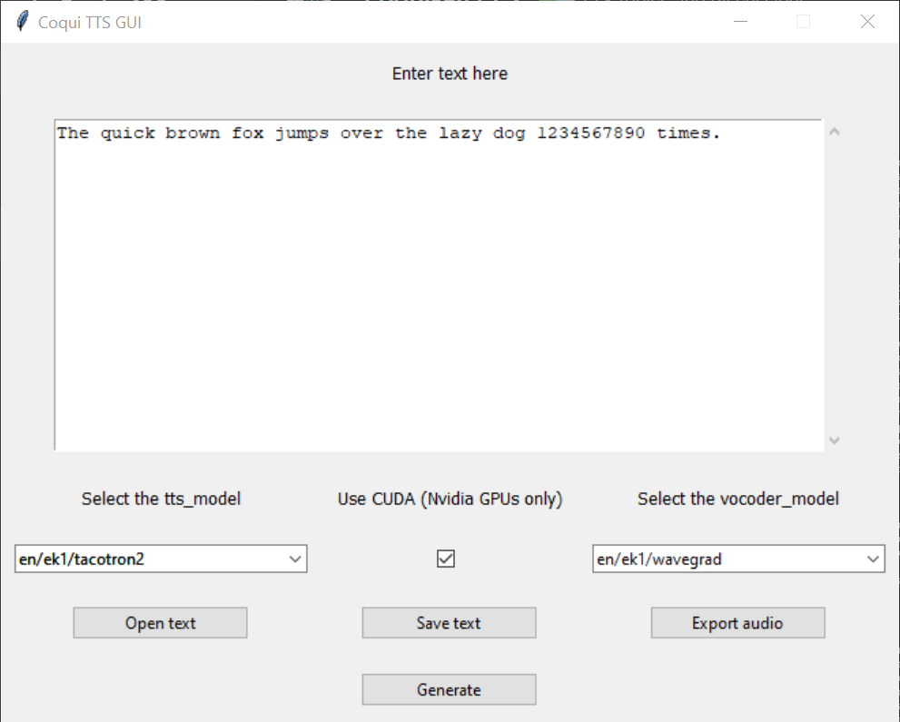

# Simple Coqui-TTS GUI

*Graphical user interface for using released Coqui-TTS and vocoder models in the form of a text editor, made using Tkinter. This project is not made nor endorsed by the authors of Coqui-TTS. Forked from older project: https://github.com/smaybius/Coqui-TTS-GUI-solution*



## How to use

First run:
```bash
git clone https://github.com/iairu/Coqui-TTS-GUI.git
cd Coqui-TTS-GUI
python -m venv venv
venv/bin/python -m pip install -r requirements.txt
venv/bin/python gui.py
```

Subsequent runs:
```bash
cd Coqui-TTS-GUI
venv/bin/python gui.py
```
